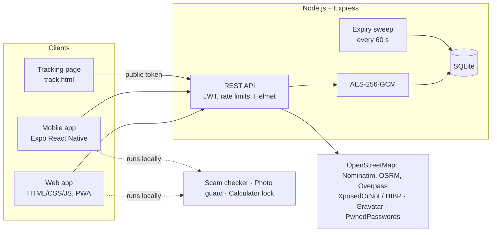

# SafeHer

**A women's safety toolkit that protects in the physical world and the digital one, and keeps her in control of her own data.**

recHERsion 2026 · ACM-W NITK Surathkal · **Problem Statement 2: Women's Safety**

| | |
|---|---|
| Team | `code.exe` |
| Demo Video | [Watch Demo Video](https://drive.google.com/drive/folders/1xujcLyp8d529M5mQ4OqE9F25W9-hUwoR) |
| Live Website | [Open SafeHer](https://safeher-womens-safety-app-v4s4.onrender.com) |

---

## The problem

Problem Statement 2 names two fronts: **physical and digital**. Harassment and unsafe situations on one side; privacy breaches, online threats and identity misuse on the other. Most safety apps cover only one of them, and many ask her to trust a company with her location and her reports.

## Our answer

SafeHer puts both fronts in one app, built around three rules:

1. **Help she can reach in seconds.** One SOS button, a 5-second cancel window, a live tracking link her contacts open in any browser (no app install needed), and an offline SMS fallback when the server is unreachable.
2. **Prevention, not just reaction.** Safer walking routes, a scam and sextortion message checker in English, Hindi, Marathi and Hinglish, a personal data-footprint scan, a photo privacy guard and a password leak check.
3. **Privacy and consent by design.** Contacts and reports are encrypted at rest, every location link expires automatically, the app can disguise itself as a calculator, and it never claims an alert was "sent" unless she confirms it.

## Feature map

### Physical safety
| Feature | What it does |
|---|---|
| **SOS with live tracking** | 5-second cancel countdown, then a public tracking link with her name and live position. Contacts get one-tap WhatsApp/SMS buttons; 112 and 181 are one tap away. |
| **Honest status panel** | Shows server link health, GPS accuracy (good / fair / poor), whether the link has been opened, and per-contact state: *not sent*, *opened*, *you confirmed sent*. Retries 3 times, then falls back to SMS. |
| **Live location sharing (no alarm)** | Explicit consent step, duration of 30 minutes to 12 hours, always-visible sharing bar, "add 30 minutes", one-tap stop. Stopping or expiry deletes stored points. |
| **Offline SOS fallback** | Contacts are cached on the device. If the server cannot be reached, an SMS with her location is prepared for all contacts. |
| **Safe walking routes** | Fetches walking alternatives from OpenStreetMap data, counts mapped police stations and shops near each path, and ranks by "most amenities" or "fastest". Missing data is shown as **unknown**, never as safe. |
| **Voice trigger (web)** | Say "help", "bachao" or "madad" to start the cancellable SOS countdown. |
| **Bluetooth SOS relay (mobile)** | Writes her SOS to nearby compatible devices over BLE. Sender side only. |
| **Background location (mobile)** | Keeps sharing with the screen off during an SOS. |

### Digital safety
| Feature | What it does |
|---|---|
| **Scam and sextortion checker** | 24 rule groups (OTP/KYC, fake police and digital arrest, blackmail, UPI collect, APK and remote-access apps, fake jobs, romance and more). Works in English, Hindi, Marathi and Hinglish, highlights the exact words that triggered each warning, lists link domains, and recognises genuine "do not share your OTP" notices. Runs on the device. |
| **Footprint scan** | Real lookups on her own email: breach data (XposedOrNot, or Have I Been Pwned with a key), Gravatar, username presence on 10 public sites, optional web-exposure search. Gives an exposure score from real findings only, removal steps and request templates. Limited to her own account email. |
| **Image Privacy Guard** | Reads hidden location, time and device data from a photo and saves a clean copy. Runs in the browser; the photo never leaves it. |
| **Password leak check** | k-anonymity: only 5 characters of a hash leave the device. |
| **Private safety reports** | 12 incident categories, incident date and time, up to 3 evidence files per report (type-checked, encrypted, owner-only), CSV export and print-to-PDF. |

### Privacy and discretion
- **Calculator disguise:** the app opens as a working calculator; a secret code plus `=` opens SafeHer. Auto-hides on app switch. The code is stored only as a salted hash.
- **AES-256-GCM encryption** for profile, contacts, reports, evidence files and feedback.
- **Consent enforced on the server**, not just in the UI: no public link is created without `consent: true`.
- **Auto-expiry** of every link (12 hours maximum); the ended notice disappears after 2 hours.
- English, Hindi and Marathi interface.

## Architecture



The scam checker (`server/public/msgcheck.js`) is shared byte for byte with the app (`app/src/lib/msgcheck.js`); a test enforces this.

| Layer | Stack |
|---|---|
| Server | Node 18+, Express, better-sqlite3, bcryptjs, jsonwebtoken, Helmet, express-rate-limit |
| Web | Vanilla JS single page app with a service worker for offline open |
| Mobile | Expo SDK 52, React Native 0.76, expo-location, expo-task-manager, expo-sms, react-native-ble-plx, expo-secure-store |

## Run it

**Server** (Node 18 or newer)
```bash
cd server
npm install
cp .env.example .env      # set JWT_SECRET to a long random string
npm start                 # http://localhost:3000, open it for the web app
```
Geolocation needs HTTPS or localhost. For contacts to open a tracking link, the server must be reachable from the internet (Render, Railway, a VPS, or an ngrok tunnel). Set `TRUST_PROXY=1` only behind exactly one trusted proxy.

**Mobile app** (development build, not Expo Go)
```bash
cd app
cp .env.example .env      # EXPO_PUBLIC_API_URL = your server address
npm install
npx expo run:android
# Disguised icon and name:  APP_DISGUISE=1 npx expo run:android
```

**Tests**
```bash
cd server && npm test     # 3 tests
cd app && npm test        # 2 tests
```

**Quick demo path (2 minutes):** register → add a contact → Start SOS and let the countdown finish → open the tracking link in a second browser tab and watch the position update → paste a scam message into the checker → compare two routes → turn on Calculator disguise → stop sharing and confirm the link now shows "ended".

## Why this fits the judging criteria

| Criterion | Where to look |
|---|---|
| **Problem relevance (15%)** | Covers both fronts named in PS2: physical (SOS, tracking, routes, relay) and digital (scams, sextortion, breaches, photo metadata, password leaks, reports). Local context: 112 and 181, UPI and digital-arrest scams, Hindi and Marathi. |
| **Innovation (15%)** | One app for both fronts; tracking links that need no install; routes ranked on mapped amenities with "unknown" shown honestly; disguise mode; delivery status that refuses to overclaim. |
| **Technical implementation (20%)** | Server-enforced consent and expiry, encrypted storage, JWT for cookie and bearer clients, k-anonymity, file signature checks, rate limits, background location task, shared checker with a drift test. |
| **Working MVP (25%)** | End-to-end flow in one session: register, contact, SOS, live tracking page, stop, deletion of points. See the demo video. |
| **Feasibility and impact (15%)** | Runs on free tiers and public data; no per-user cost; contacts need nothing installed. |
| **UX and accessibility (10%)** | 5-second cancel to prevent false alarms, large controls, light and dark themes, reduced-motion support, three languages, plain-language status messages. |

## Honest limits

We would rather you hear these from us.

- **Alerts are not silent.** WhatsApp and SMS open pre-filled and she must press Send; the web and phone platforms do not allow silent sending. The app therefore marks a contact as sent only after she confirms. Automating delivery with a provider such as Twilio is the natural next step.
- **Routes** use public OpenStreetMap services that can rate-limit or have gaps. The amenity count is a signal, not a safety guarantee.
- **The scam checker is a heuristic.** It can miss new scams and can flag genuine messages; feedback buttons feed rule improvements.
- **Footprint scan** "nothing found" means these sources had no match, not that nothing exists.
- **Voice trigger** works in the web app only (Chrome or Edge, page open, needs internet). **Bluetooth relay** needs a compatible receiver app.
- **Tested** by the team end to end (SOS, live tracking, contacts, reports, scam checker, routes, disguise), plus unit and smoke tests and a successful Android bundle build. Behaviour can still vary across phone models, OS versions and network conditions, especially background location, SMS and Bluetooth.

## Roadmap

Silent delivery through Twilio, a receiver app for the Bluetooth relay, a trusted-contact check-in timer ("tell me when I arrive"), more Indian languages for the scam checker, and a community-reported unsafe-places layer on the route map.

## Originality and acknowledgements

All application code is the team's own work. Third-party services and libraries, used under their terms: OpenStreetMap (Nominatim, Overpass) and the OSRM foot routing instance, XposedOrNot, Have I Been Pwned (Pwned Passwords and optional breach API), Gravatar, Brave Search API (optional), Expo and React Native, react-native-ble-plx, Express, better-sqlite3, bcryptjs, jsonwebtoken, Helmet, express-rate-limit.

Further detail: [server API and limits](server/README.md) · [earlier build notes](docs/BUILD-NOTES.md)

*She imagines. She builds. She leads.*
